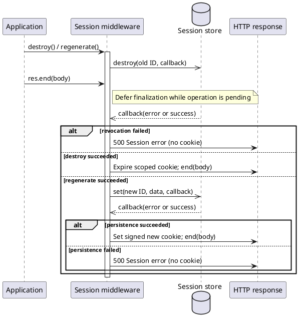

# Session and cookie security

## Proxy trust is explicit

`Request.ip`, `Request.protocol` and `Request.secure` default to the actual socket.
Client-supplied `X-Forwarded-For`, `X-Real-IP` and `X-Forwarded-Proto` are ignored.
An application may opt in on its serving Router, or use `req.trustProxy` in early
middleware **before reading these properties**:

```js
const app = new Router({
  trustProxy: peer => peer === process.env.TRUSTED_PROXY_IP
});

app.use(session({
  secret: process.env.SESSION_SECRET,
  proxy: peer => peer === process.env.TRUSTED_PROXY_IP,
  cookie: { secure: 'auto', httpOnly: true, sameSite: 'lax' }
}));
```

These are separate policies: `req.trustProxy` controls general Request getters;
session `proxy` controls session cookie protocol detection and fingerprint IP.
Router `trustProxy` initializes the Request setting on simple and middleware paths,
including composed nested routes. The serving Router owns the network boundary;
a nested Router's constructor option does not override it. Boolean `true` trusts
every immediate peer. Prefer a peer predicate, restrict direct network access,
and require the reverse proxy to **overwrite/sanitize the complete forwarding
headers**. This is not an arbitrary multi-hop proxy-chain resolver. Forwarded
protocols must be `http`/`https`; forwarded IPs must be valid IP literals.

`secure: 'auto'` is resolved independently for each new, loaded or regenerated
session. It does not mutate shared middleware options. A protocol-policy change
on a loaded session also triggers persistence and cookie reissue. Use
`secure: true` with HTTPS-only access for production authentication cookies;
`auto` intentionally permits non-Secure cookies on HTTP. Fingerprinting is
optional defense in depth, not authentication: addresses/user agents change
and user-agent values can be forged.

## Persistence, revocation and concurrency

| Operation | Behavior on failure | Source |
|---|---|---|
| Store read / malformed record | Generic session error; no authenticated route execution | `session.js` initialization |
| Automatic or explicit save | HTTP 500 `Session error`, no success payload or Set-Cookie | response finalizer |
| Destroy / regenerate | Callback receives error; old ID/data are not reported as successfully revoked | `Session.destroy` / `regenerate` |
| Response ended while save/destroy/regenerate/reload is pending | Finalization waits for the complete callback-started operation chain, even if caller omitted callbacks | pending-operation waiter |
| Concurrent operation rejected while another is pending | Failure remains latched for this request, even if the original operation succeeds | operation guard |
| Store callback invoked twice | Only the first completion is accepted | `callStore` |
| Failure after headers are sent | Connection aborted; previously sent bytes cannot be recalled | response finalizer |
| MemoryStore stale write after logout/rotation or a newer update | Rejected using internal optimistic revision metadata | `MemoryStore.get` / `set` |

Store methods remain callback APIs. They must complete exactly once and enforce
their own finite operation timeouts; middleware does not invent a timeout for an
unknown backend. Synchronous store throws are treated as callback errors. An
operation callback may start the next operation; response finalization waits until
the whole chain and all synchronous completion callbacks are quiescent.
All `res.end` callback overloads also survive a replacement session-error response.
They settle once after the replacement transport finishes, or with a transport
error when the connection actually closes prematurely—not when persistence fails
or `end()` is merely invoked. A completed HTTP 500 is a normal transport completion;
the session failure remains available separately as `req.sessionError`.
Session errors are retained server-side in `req.sessionError`; explicit methods
also return their error through the callback. Do not log session data, identifiers,
cookies or raw backend messages. Wire redacted operational diagnostics in the app.

Nested session changes and cookie changes are detected by comparing JSON storage
data at response completion. Data must be JSON-serializable. Regeneration uses the
configured `genid`, requires a fresh non-empty string without dots, revokes the old
ID first, clears business data except `keepOnRegenerate`, and preserves the internal
fingerprint. Reserved prototype/method names cannot be hydrated as session data.
Destroy clears `req.sessionID` and expires the cookie with the original path,
domain and security attributes. Saving a destroyed session cannot recreate it.

The default MemoryStore prevents stale loaded requests from restoring revoked
IDs or overwriting newer writes. A conflict returns a session error rather than
silently applying last-writer-wins. Retry application operations deliberately;
do not blindly retry security transitions. Explicit direct store writes are an
administrative API and do not carry a loaded request's revision automatically.

**Custom/distributed stores must implement atomic update/revocation or version
checks themselves**, including across workers/processes. The callback interface
alone cannot make a remote read-modify-write transactional. MemoryStore is
process-local, has no durability/capacity guarantee, and is unsuitable as a
multi-instance authentication store. Concurrent session operations within one
request are rejected; wait for each operation's callback before starting another.

Save session changes explicitly and await the callback **before streaming or
flushing headers**, because end-time persistence cannot withhold already sent
bytes. Session cookie emission is designed for buffered `res.send`/`res.json`.
Session and compression middleware may be registered in either order. Compression
intercepts native transport methods, not the wrapper's session finalization
barrier. Persistence failure discards any unflushed compression buffer and removes
authentication/redirect/encoding headers case-insensitively before sending a
generic HTTP 500 with `Cache-Control: no-store`. Once bytes have reached the
transport, failure aborts the connection rather than attempting to rewrite them.
Compression preserves write callbacks, backpressure and drain signals. Before
its threshold, a write callback acknowledges bounded-buffer acceptance, not
delivery. Producers must respect false write returns; output pauses while the
socket is blocked and compression is destroyed on disconnect. Static callbacks
that fail after a logical body write abort the response rather than mixing a
buffered failed prefix with a generic error or downstream body.



## Expiration and serialization

Stored `expires` is an absolute server-side deadline. Hydration and ordinary
writes do not reset it; only `rolling` explicitly renews `originalMaxAge`.
Expired or invalid deadlines are rejected even when a custom store has no TTL
enforcement. Stores should still remove expired records. `maxAge` is milliseconds
in the API and whole seconds in Set-Cookie; browser expiry has second precision.
Cookies without a deadline are browser-session cookies, not a finite server TTL.

`Response.cookie()` rejects invalid configuration instead of silently dropping
the cookie. This is an intentional security compatibility correction:

- Names must be HTTP tokens. Values are URI encoded; `+` remains `+` after parsing.
- Path/domain cannot inject attributes or control characters. Paths start with `/`.
- Max age must be a finite number; Expires must be a valid Date.
- `SameSite=None` requires `Secure`; `__Secure-` requires `Secure`;
  `__Host-` also requires `Path=/` and no Domain.
- HttpOnly remains enabled unless explicitly disabled.
- The first duplicate Cookie name wins, matching browser path ordering; apps must
  avoid issuing conflicting same-name authentication cookies on multiple paths.
- HMAC validation compares equal-length byte buffers, including malformed Unicode
  signatures, without throwing. `req.signedCookies` contains only verified values;
  invalid signed-looking values remain untrusted in `req.cookies` for compatibility.
- `cookieParser(secret)` configures verification and response signing without a
  Router `cookieSecret`; if both are set, they must match. Register before cookie
  getters are first accessed. Session cookies are independently verified,
  including when a general cookie secret is shared.

Applications still own CSRF protection, authorization, login rate limits, secret
management/rotation, session lifetime/capacity policy and trusted-proxy topology.
Signed cookies provide integrity, **not encryption**. Do not place secrets in them.

## Regression coverage

`node tests/test-session-security.js` covers spoofing, transport transitions,
fingerprints, nested edits, store errors/throws/duplicate callbacks, stale writes,
revocation, callback chaining/overlap, both compression orders, case-insensitive
failure-header cleanup, expiration, signing, parser ambiguity and cookie abuse.
Existing session/cookie/request/compression suites provide compatibility checks.

Node's current `crypto.timingSafeEqual` documentation requires equal byte lengths:
<https://nodejs.org/api/crypto.html#cryptotimingsafeequala-b>.
